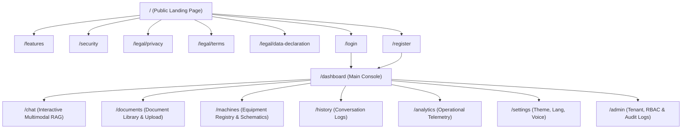
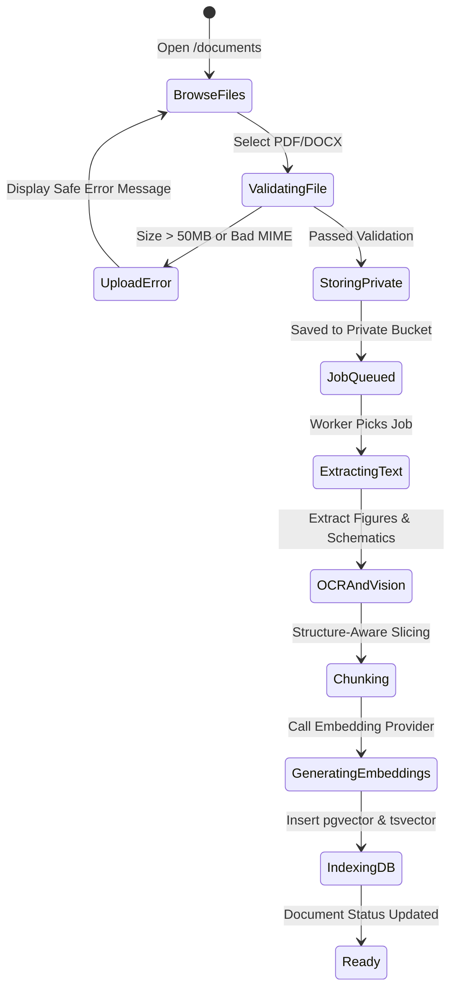
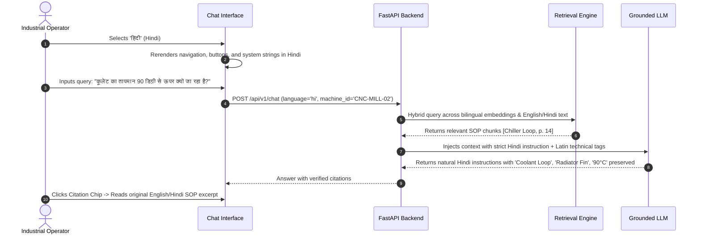

# APP_FLOW.md — Application Navigation & Journey Architecture

> **Product**: ForgeWise AI (Vikrant 5.0 Platform)  
> **Date**: October 20, 2026  

---

## 1. Global Sitemap & Route Hierarchy

---

## 2. Detailed User Journeys & State Transitions

### Journey A: Public Visitor Exploration
1. **Entry**: Visits `/`.
2. **CAD 3D Interaction**: Explores the interactive 3D assembly; hovers on machine sub-assemblies to see how SOP sections map to physical parts.
3. **Architecture Review**: Reads technical features at `/features` and enterprise controls at `/security`.
4. **Compliance Review**: Checks `/legal/privacy`, `/legal/terms`, and `/legal/data-declaration`.
5. **CTA Transition**: Clicks "Explore the Platform" or "Sign In" $\rightarrow$ `/login`.

---

### Journey B: Document Manager (SOP Upload & Vector Processing)

---

### Journey C: Frontline Industrial Worker (Diagnostic Troubleshooting)
1. **Context Initialization**: Worker visits `/chat`.
2. **Machine Scope Filter**: Selects target equipment (e.g. `PMP-402 Centrifugal Pump`) or leaves unconstrained.
3. **Language Selection**: Chooses English or Hindi; interface and placeholder texts dynamically translate.
4. **Query Input**:
   - Types query or clicks microphone button to activate Web Speech voice input.
   - Example query: *"Why is the pump motor vibrating excessively above 2400 RPM?"*
5. **Retrieval Execution**:
   - Backend queries pgvector for cosine similarity + PostgreSQL FTS for keyword matches.
   - Reciprocal Rank Fusion aggregates chunks.
   - If max score $< 0.62$, returns `insufficient_evidence` response with safety escalation.
6. **Synthesis & Citation**:
   - Grounded LLM synthesizes response with numbered steps and Lockout/Tagout cautions.
   - Response includes interactive citation chips `[Pump Manual v2, p. 45]`.
7. **Source Inspection**:
   - Worker clicks citation chip; slide-over drawer displays the verified excerpt and page snippet.
8. **Feedback & Speech**:
   - Worker clicks "Repeat Answer" to listen via TTS or submits a helpfulness rating (+1 / -1).

---

### Journey D: Bilingual Worker Interaction (Hindi / English)

---

### Journey E: Organization Administrator (User & Audit Governance)
1. **Access**: Navigates to `/admin` (enforced via server-side role check `org_admin`).
2. **Member Management**: Invites new engineers/operators via email; assigns granular roles (`Viewer`, `Operator`, `Engineer`, `Knowledge Manager`, `Org Admin`).
3. **Audit Log Inspection**: Reviews tamper-evident event stream (login events, document uploads, document deletions, role modifications).
4. **Provider Status**: Inspects AI provider connectivity (OpenAI, Gemini, Ollama, Redis, PostgreSQL).
