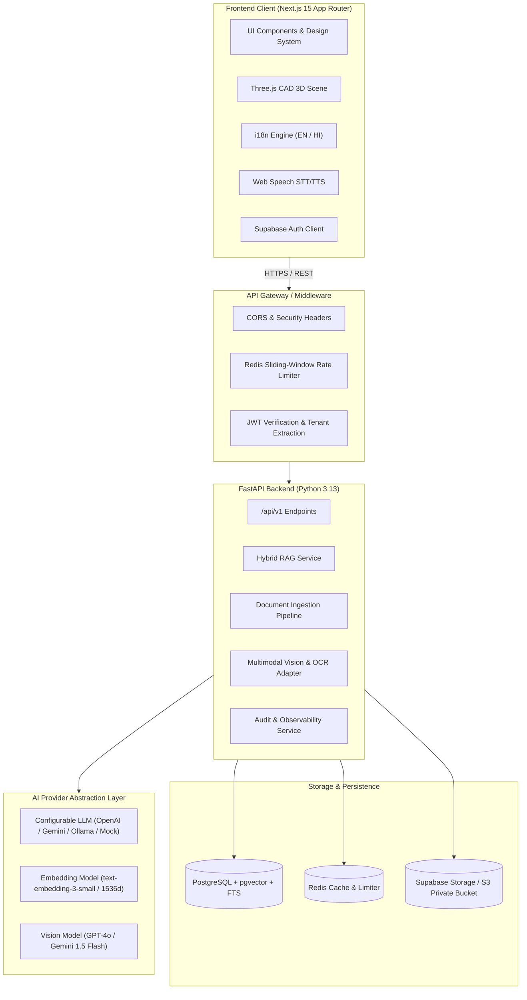

# TRD.md — Technical Requirements Document

> **Architecture Specification**: ForgeWise AI Platform (Vikrant 5.0)  
> **Target Version**: Production Monorepo v1.0.0  
> **Date**: October 20, 2026  

---

## 1. System Architecture Overview



---

## 2. Technology Stack & Component Specifications

### 2.1 Frontend (`apps/web`)
- **Framework**: Next.js 15 (App Router, Server & Client Components)
- **Language**: TypeScript 5.6+ with strict type checking (`strict: true`, `noImplicitAny: true`)
- **Styling**: Tailwind CSS 3.4+ with centralized HSL design tokens, CSS custom variables
- **UI Primitives**: Headless accessible components modeled on shadcn/ui & Radix UI
- **Icons**: Lucide React
- **Animations & Motion**: Framer Motion 11+ with respect for `prefers-reduced-motion`
- **3D Interactive Scene**: Three.js 0.169+ and `@react-three/fiber` with fallback poster
- **Forms & Validation**: React Hook Form with Zod schemas
- **State & Data Fetching**: Native React hooks, typed API client with abort controllers
- **Internationalization**: Lightweight custom i18n context with typed dictionaries (`messages/en.json`, `messages/hi.json`)

### 2.2 Backend (`apps/api`)
- **Framework**: FastAPI 0.115+
- **Runtime**: Python 3.13+
- **Validation & Serialization**: Pydantic v2.9+
- **ORM & Database Client**: SQLAlchemy 2.0+ (async engine) & AsyncPG
- **Database Migrations**: Alembic
- **Document Processing**: PyPDF / pypdf, python-docx, Pillow, PyTesseract / easyocr adapter
- **Vector Math**: pgvector-python and numpy
- **Rate Limiting**: Redis token-bucket / sliding window with fallback in-memory cache
- **Testing**: Pytest, pytest-asyncio, httpx

### 2.3 Database & Storage Layer
- **Engine**: PostgreSQL 16+ with extensions:
  - `uuid-ossp` or `pgcrypto` for UUIDv4 generation
  - `vector` (pgvector) for dense semantic vector similarity
  - `pg_trgm` and English/simple FTS dictionaries for lexical search
- **Object Storage**: Supabase Storage / AWS S3 compatible private bucket
  - No public read access
  - Signed URLs generated with 900-second (15-minute) TTL
  - Bucket name: `industrial-documents-private`

---

## 3. Database Schema Contract

### 3.1 Core Entity Relationship Model
1. **`organizations`**: Multi-tenant container (ID, name, slug, tier, max_storage_bytes, created_at)
2. **`users` / `profiles`**: User metadata, organization_id, role (`viewer`, `operator`, `engineer`, `knowledge_manager`, `org_admin`, `platform_admin`), language preference (`en`, `hi`), theme preference (`light`, `dark`, `high-contrast`)
3. **`machines`**: Physical assets (ID, org_id, identifier e.g. `PMP-402`, name, manufacturer, model, plant_location, created_at)
4. **`documents`**: Uploaded SOPs/manuals (ID, org_id, machine_id nullable, title, file_name, file_key, mime_type, file_size_bytes, status [`pending`, `processing`, `ready`, `failed`], version, created_at)
5. **`document_chunks`**: Segmented content (ID, document_id, org_id, chunk_index, page_number, section_title, content, embedding vector(1536), tsv_content tsvector, metadata_json)
6. **`document_images`**: Extracted figures & schematics (ID, document_id, page_number, image_key, caption, ocr_text, vision_description, created_at)
7. **`conversations`**: Chat sessions (ID, org_id, user_id, machine_id nullable, title, language, created_at)
8. **`messages`**: Dialogue history (ID, conversation_id, sender [`user`, `assistant`, `system`], content, groundedness_status [`supported`, `insufficient_evidence`, `needs_review`], latency_ms, created_at)
9. **`citations`**: Verifiable references (ID, message_id, chunk_id, document_id, page_number, excerpt, relevance_score)
10. **`audit_logs`**: Security & compliance trail (ID, org_id, user_id, action, target_type, target_id, ip_address, created_at)
11. **`analytics_events`**: Operational telemetry (ID, org_id, event_type, query_text_sanitized, latency_ms, citation_count, is_unanswered, created_at)

---

## 4. API Endpoints Contract (`/api/v1`)

| Method | Endpoint | Description | Auth Required | Minimum Role |
|--------|----------|-------------|---------------|--------------|
| `GET` | `/health` | System health, DB & Redis ping | No | Public |
| `GET` | `/auth/me` | Current user profile & org role | Yes | Viewer |
| `POST` | `/chat` | Grounded RAG query submission | Yes | Viewer |
| `GET` | `/chat/history` | List user conversation threads | Yes | Viewer |
| `GET` | `/chat/{conv_id}` | Fetch conversation messages & citations | Yes | Viewer |
| `DELETE` | `/chat/{conv_id}`| Soft/Hard delete conversation thread | Yes | Viewer |
| `POST` | `/documents/upload` | Multipart file upload with metadata | Yes | Knowledge Manager |
| `GET` | `/documents` | List organization documents with filters | Yes | Viewer |
| `GET` | `/documents/{doc_id}`| Retrieve document details & status | Yes | Viewer |
| `GET` | `/documents/{doc_id}/pages/{page}` | Fetch signed URL for page preview | Yes | Viewer |
| `DELETE` | `/documents/{doc_id}` | Purge document, chunks, & storage file | Yes | Knowledge Manager |
| `POST` | `/documents/{doc_id}/reprocess` | Trigger re-extraction & re-embedding | Yes | Knowledge Manager |
| `POST` | `/search` | Direct hybrid search without generation | Yes | Viewer |
| `GET` | `/machines` | List registered plant equipment | Yes | Viewer |
| `POST` | `/machines` | Register new equipment or line asset | Yes | Engineer |
| `GET` | `/analytics/overview` | Aggregated query, latency & failure KPIs | Yes | Org Admin |
| `POST` | `/feedback` | User rating (+1/-1) and remarks on answers | Yes | Operator |
| `GET` | `/admin/users` | List organization members & roles | Yes | Org Admin |
| `GET` | `/admin/audit-logs` | Query filtered security audit events | Yes | Org Admin |

---

## 5. RAG Pipeline & Multi-Stage Retrieval Engine

### 5.1 Hybrid Scoring Formula
The retrieval engine combines vector similarity and lexical full-text ranking using Reciprocal Rank Fusion (RRF):
$$RRF(d) = \frac{w_{vec}}{k + rank_{vec}(d)} + \frac{w_{fts}}{k + rank_{fts}(d)}$$
- $k = 60$ (smoothing constant)
- $w_{vec} = 0.65$ (semantic weight)
- $w_{fts} = 0.35$ (lexical weight for exact parts, error codes, and DIN standards)

### 5.2 Relevance Thresholding & Grounding Verification
1. Minimum composite similarity threshold: $0.62$.
2. If top retrieval score $< 0.62$, the system automatically suppresses generation and issues an explicit `insufficient_evidence` response:
   > *"No verified operational procedures or manual sections were found matching this query. Please consult a qualified plant engineer or upload the relevant OEM documentation."*
3. Every generated statement containing technical guidance is checked against retrieved chunk IDs. Only chunks explicitly used in generation are returned as clickable citations.

---

## 6. Multilingual Architecture (English & Hindi)
- System prompts dynamically inject the requested locale:
  ```
  Answer strictly in {language}. Retain all standard industrial identifiers, 
  error codes (e.g. 'E-104'), part numbers, and units (e.g. 'bar', 'RPM', 'Nm') 
  in Latin script. For Hindi, provide clear technical Devanagari with English 
  terms in parentheses when clarifying terminology.
  ```
- Retrieval queries are dual-indexed: Hindi queries are semantic-matched against bilingual vector space, while technical codes are extracted via regex and queried directly in FTS.

---

## 7. Security & Threat Modeling
- **Prompt Injection Defense**: All user-provided queries and retrieved document excerpts are isolated inside XML tags `<user_query>` and `<context_documents>` with explicit instructions to ignore instructions contained within documents.
- **Tenant Isolation**: Every SQL query injects `WHERE organization_id = :current_user_org_id` at the database repository layer.
- **Rate Limiting**:
  - Chat: 30 requests / minute per user
  - Document Upload: 10 uploads / hour per user
  - Public endpoints: 60 requests / minute per IP
- **File Integrity**: Magic-byte verification confirms file headers match declared MIME type before storage dispatch.
